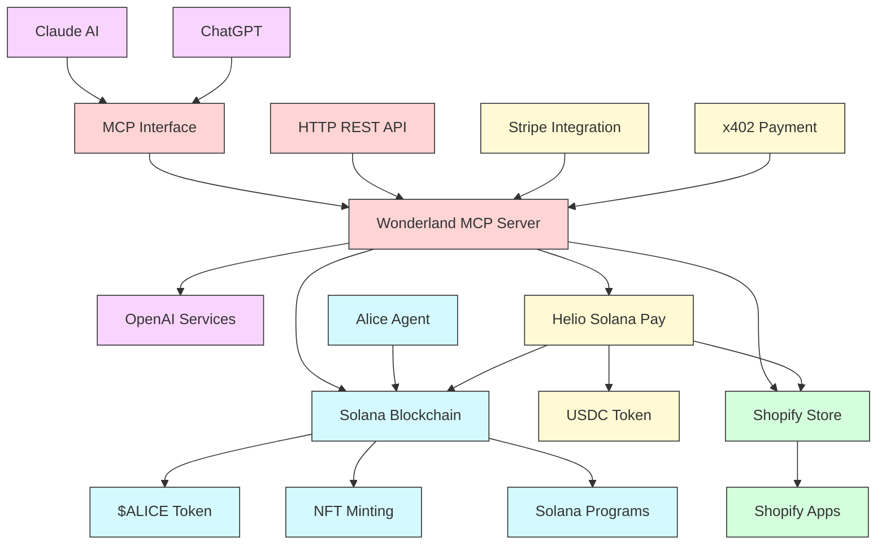

# Wonderland MCP: AI-Powered Solana Ecosystem

Wonderland MCP is a powerful Model Context Protocol (MCP) server that connects AI models to the Solana blockchain, enhanced with Helio Solana Pay, Shopify integration, and powered by the Alice Agent and $ALICE token.


## 🌈 Overview

Wonderland MCP bridges the gap between AI models (Claude, ChatGPT) and blockchain technology, creating a seamless platform for AI-powered crypto applications, e-commerce solutions, and NFT experiences. Our platform combines the power of multiple technologies to create an end-to-end solution:

- **AI Integration**: Connect Claude or ChatGPT to blockchain operations via MCP
- **Solana Blockchain**: Process fast, low-cost transactions and mint NFTs
- **$ALICE Token**: Power the ecosystem with our native utility token
- **Alice Agent**: Execute automated tasks on the blockchain
- **Helio Solana Pay**: Process cryptocurrency payments
- **Shopify Integration**: Connect blockchain payments to e-commerce
- **Extended Services**: x402, Stripe integration, and more

## 🔄 System Architecture



## ✨ Core Components & Features

### AI Layer
- **Claude & ChatGPT Integration**: Connect AI models to blockchain operations
- **OpenAI Services**: Generate images and content for NFTs and e-commerce
- **Natural Language Interface**: Control blockchain operations with simple text commands

### Blockchain Operations
- **Solana Blockchain**: Fast, low-cost transactions and smart contracts
- **$ALICE Token**: Native utility token powering the ecosystem
- **NFT Minting**: Create, customize, and deploy NFTs directly from AI
- **Alice Agent**: Automated task execution and scheduling on Solana

### Payment Solutions
- **Helio Solana Pay**: Generate and manage Solana Pay links for USDC payments
- **USDC Support**: Accept stable coin payments with real-time processing
- **x402 Integration**: Additional payment methods for comprehensive coverage
- **Stripe Integration**: Connect traditional payment methods to crypto operations

### E-commerce & Application Layer
- **Shopify Integration**: Connect blockchain payments to product catalogs
- **Product Linking**: Associate digital assets and NFTs with physical products
- **Custom Store Solutions**: Tailor blockchain solutions for e-commerce needs

## 🚀 Getting Started

### Prerequisites
- Node.js (v16 or higher)
- Solana wallet with SOL for transaction fees
- API keys for integrated services

### Quick Start

1. **Clone & Install**
   ```bash
   git clone https://github.com/yourusername/wonderland-mcp.git
   cd wonderland-mcp
   
   # Install server dependencies
   cd server && npm install
   
   # Install client dependencies
   cd ../client && npm install
   ```

2. **Configure Environment**
   ```bash
   # Copy example environment files
   cp server/.env.example server/.env
   cp client/.env.example client/.env
   
   # Edit .env files with your API keys and configuration
   ```

3. **Start Server**
   ```bash
   cd server && npm start
   ```

4. **Connect Claude Desktop**
   ```bash
   cd client && ./claude-desktop-start.sh
   ```

## 🔌 Integration Points

### 1. AI Model Integration

Connect through:
- **Claude Desktop**: MCP protocol for direct AI-to-blockchain operations
- **OpenAI API**: Image generation and content creation capabilities
- **Custom LLM Deployments**: Self-hosted models via the HTTP API interface

### 2. Blockchain Operations

Interact with:
- **Solana RPC**: Direct blockchain transactions and queries
- **$ALICE Token**: Utility token for ecosystem operations
- **NFT Assets**: Mint, transfer, and manage digital collectibles
- **Alice Agent**: Programmatic task execution and monitoring

### 3. Payment Processing

Accept payments via:
- **Helio Solana Pay**: USDC payment links and processing
- **x402**: Advanced crypto payment solutions
- **Stripe**: Traditional payment method bridge
- **Custom Integrations**: Flexible payment adapter system

### 4. E-commerce Solutions

Connect with:
- **Shopify**: Product catalog integration and e-commerce operations
- **Custom Storefronts**: API access for bespoke retail experiences
- **Digital Asset Marketplaces**: NFT and digital good sales platforms

## 💻 Usage Examples

### AI-Powered NFT Creation

```
Generate an image of a surreal landscape with floating islands and mint it as an NFT called "Wonderland Heights" with rarity attributes for island count and dream level.
```

### E-commerce Payment Processing

```
Create a Solana Pay link for 49.99 USDC for the Shopify product "Wonderland VR Experience" with variant "Premium Access" and send confirmation to customer@example.com
```

### Combined Operations

```
Generate product images for the "Summer Collection", create NFT certificates of authenticity for each item, and set up payment links connected to the Shopify store inventory.
```

## 🛠️ Developer Resources

- [API Documentation](docs/api.md): HTTP API details
- [MCP Protocol Guide](docs/mcp-protocol.md): Working with AI models
- [Solana Integration](docs/solana.md): Blockchain operations
- [Payment Processing](docs/payments.md): Setting up payment systems
- [E-commerce Guide](docs/ecommerce.md): Shopify and store integration

## 🔐 Security Considerations

- **API Keys**: Never share your private keys or .env files
- **Authentication**: Use proper authentication for production deployments
- **HTTPS**: Always use HTTPS in production environments
- **Rate Limiting**: Implement rate limiting for public-facing endpoints
- **Access Control**: Limit sensitive operations to authorized users

## 🤝 Contributing

Contributions welcome! Please check our [contribution guidelines](CONTRIBUTING.md).

## 📄 License

This project is licensed under the MIT License - see the [LICENSE](LICENSE) file for details.

## 🙏 Acknowledgements

- [Model Context Protocol](https://github.com/anthropics/anthropic-tools)
- [Solana Ecosystem](https://solana.com)
- [OpenAI](https://openai.com)
- [Helio](https://helio.example) (Solana Pay Provider)
- [Alice Agent](https://alice.example) (Automated task execution on Solana)
- [Shopify](https://shopify.com)
